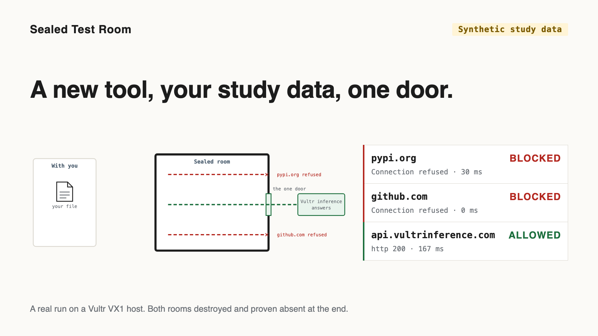
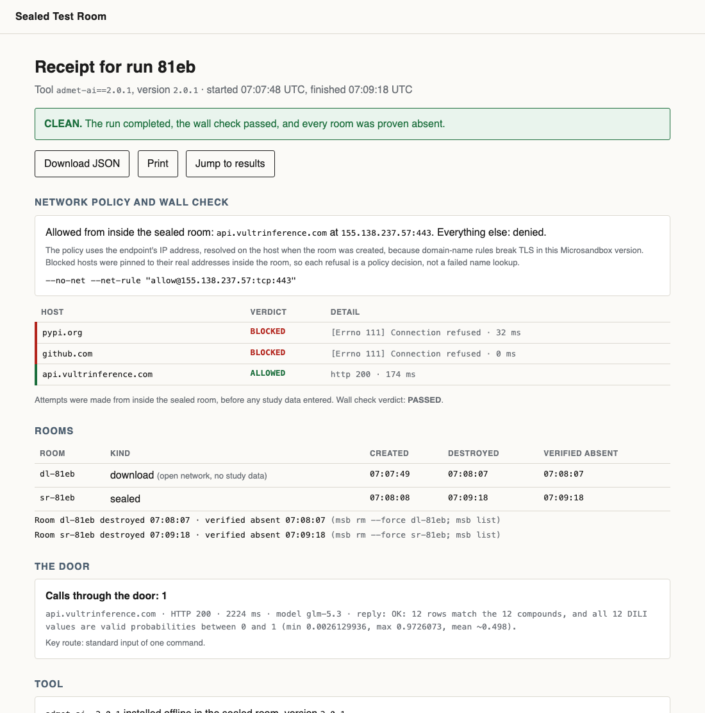
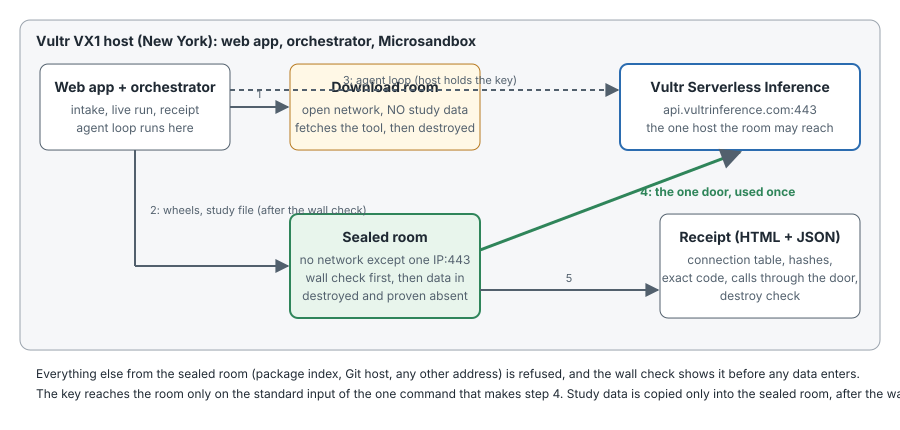

# Sealed Test Room

**A scientist gets to try a new, untrusted analysis tool on confidential study data, and IT gets a receipt that proves the tool could reach exactly one host, and that the room is gone.**

Built for the Vultr Agent Rush hackathon (Challenge 1, "Blast Radius Zero").

*A real receipt from a run on a Vultr VX1 host. The data in it is synthetic and says so. The connection table is the point: the package index and the Git host are refused from inside the room, the inference endpoint is reachable, and the room is proven gone at the end.*

## Who it is for

- **The study director (the scientist).** She has a new prediction tool and a confidential study file, and change control says "not yet" to anything unreviewed. She hands the room the tool and the file and gets results back.
- **The approver (IT or QA).** One page, no trust in a model needed: which tool and version, the exact code that ran, hashes of every file in and out, which connections were attempted and what happened to each, and when the room existed and the proof it is gone.
- **The buyer (the manager of a regulated-data team).** Pharma safety groups, contract research organizations and consultancies that keep saying "not yet" to useful tools because nobody can show what a tool did.

**Pricing hypothesis (a hypothesis, not a measured number):** per sealed run, because the unit the approver signs off is one run with one receipt.

## Why the room has one door

A tool that calls a model needs exactly one host. So the sealed room is created with no network except one address, the Vultr Serverless Inference endpoint, and the **wall check** proves that before any study data enters: from inside the room the package index and the Git host must be refused and the endpoint must answer. Anything else stops the run.

In this version the room uses its door once, near the end: a short result check is made **from inside the room** to the endpoint (the receipt shows it as "Calls through the door: N", with host, latency and model). What happens to the inference key, exactly:

> The agent loop runs on the host. The inference key is never in the room while the tool runs. For the single result-verification call it is passed on the standard input of that one command (not in the environment, not on the command line, not written to the room's disk), the room can reach only the inference endpoint, and the room is destroyed afterwards. The call is reported by code running in the room: if a tool had tampered with the room's own Python installation, that report could be wrong, so the wall check and the host's own result check do not depend on it.

This is the narrowest route that worked. Microsandbox 0.7.13 has a host-scoped secret option (`msb create --secret`), but it is refused by the proxy when the room's policy is an IP-only rule, and the variant that works needs open DNS and TLS interception, which would weaken the wall. Both were measured on the host (the first answers `403 secret_policy_denied`); `scripts/door_probe.py` re-checks the shipped route and prints only MATCH or NO MATCH for the key in the room's environment and on its disk.

The host's own check of the results stays authoritative; the model's reply is recorded next to it, never trusted over it.

## Scope

v1 supports one approved tool (`admet-ai` 2.0.1); the policy (one door, wall check, destroy check, receipt) applies to any tool, and the agent loop is tested on this one. Any other tool name posted to the app is refused before a run or a room exists.

## How a run works

1. **Sealed room** (a microVM created with `--no-net` and one allow rule for the inference endpoint's IP on port 443) is opened first, empty.
2. **Wall check**, before anything else enters, then the gate where you choose whether your file goes in: from inside the sealed room the agent tries the package index, the Git host and the inference endpoint. Two must be refused and one must succeed. If not, the run stops and no tool is fetched.
3. **Download room** (a Microsandbox microVM, default network, no study data inside, 1024 MB): the tool's wheels are fetched, hashed, packed into one tar file and copied out. The room is destroyed. The tar file is copied into the sealed room and installed offline.
4. **Data in, results out**: the study file is copied in (SHA-256 recorded), the agent writes and runs a runner script, the results file is copied out (SHA-256 recorded). The host checks the results itself.
5. **The door**: the room makes its one result-check call to the endpoint (see above).
6. **Destroy check**: when you close the room (or the wait runs out), it is removed and `msb list` is run to prove it is gone.
7. **Receipt**: one JSON record per run (the same record shows what you decided and when) (schema in `schemas/receipt.schema.json`) and one printable HTML page.

## Vultr services used

- **Vultr Cloud Compute, VX1 (`vx1-g-2c-8g-120s`, New York)**: hosts the web app, the orchestrator and the microVMs; `/dev/kvm` is required.
- **Microsandbox (`msb` 0.7.13) on that host**: creates, executes in, copies to and from, and removes the rooms.
- **Vultr Serverless Inference** (OpenAI-compatible, `glm-5.3`, fallback `qwen3.8-27b`): runs the agent loop, makes the in-room result check, and is the single host the sealed room may reach.

## Try it

The app is served at **https://45-63-20-61.sslip.io**. It asks for an access code once (a signed cookie keeps it for the browser session); the code for judges is given in the submission text and is never stored in this repository. A wrong code starts nothing: no run, no room. The code is set by `JUDGE_ACCESS_CODE` in the host's environment file.

The site is served over HTTPS (Caddy with a Let's Encrypt certificate, on a hostname derived from the host's IP address through the sslip.io wildcard DNS service). Some networks refuse to resolve sslip.io names; for those, `http://45.63.20.61` serves the same app over plain HTTP, where the access code is not encrypted in transit.

The app walks you through seven screens, and you decide at each one while the agent does the work: (1) the tool, with its name, version, source and what it produces; (2) the data, with a preview of the first rows, the columns, the row count, the SHA-256 and the synthetic badge, then a confirm; (3) the room, drawn as a box with one door, its walls tested while you watch, and then the question "Walls tested. Send your file in?" (answer no and the room is destroyed with nothing inside it); (4) the agent at work, with its plan in plain words and a picture that shows where your file is at every moment; (5) your results table first, with two reference labels; (6) you close the room yourself; (7) the room is shown gone and verified, and you attach the receipt to the study with your name and the time recorded. An "Audit trail" control on every screen from step 3 on, and on the receipt, opens the full record: policy, wall rows, rooms, commands, hashes, code and door calls. The wall-check rows appear after a few seconds; a full run takes a few minutes. Two runs can be in progress at once (a third visitor is told how long to wait); a gate or a close that nobody answers within two minutes ends the run safely (no answer at the gate counts as no), and a run has six minutes of working time, so a room is normally free again within ten minutes (two minutes at the gate, six of working time, two at the close). Model calls and exec steps are cut at the run cap; a copy or a room removal that hangs on the host is not, and can hold a room longer.

To run it yourself: Linux host with `/dev/kvm`, `msb` 0.7.13, Python 3.12, `pip install -r requirements.txt`, set `VULTR_INFERENCE_API_KEY` and `JUDGE_ACCESS_CODE`, then `uvicorn sealed_room.web:create_app --factory`. Tests: `pip install -r requirements-dev.txt && pytest`.

## What this is not

- The demo study data is synthetic and says so on every screen.
- A run is not a validated or GLP-compliant process, and nothing here claims approval by any real IT department. The "approved list" in the app is the demo's own list.
- The tool's numbers are the tool's output as measured in that run; they are not a claim that the tool is accurate.
- Domain names in Microsandbox 0.7.13 allow rules break TLS, so the policy uses the endpoint's IP address, resolved on the host at room creation and recorded in the receipt.
- Two sealed rooms at once is a measured limit of this one host, not a design claim. Host: Vultr VX1, 2 vCPUs, 7.9 GB memory. Measured 2026-11-06 on the same tree, command-line runs of the demo tool and study (no person at the gate): one run with a 2048 MB sealed room finished clean in 85 s, 5.2 GB memory still available at the lowest point; two runs at once, three trials, six runs, all finished clean in 114 to 156 s (wall-check rows at 1 s in every run), 3.1 GB available at the lowest point. Rooms were not tried below 2048 MB, and three at once was not tried. Two runs share two CPUs, so a run takes about 40 to 80 percent longer when another is running.
- Tool output the agent reads is sent to the inference endpoint, which states that data is processed in memory and not stored persistently by default (docs.vultr.com, 2026-10-26).

## License

MIT, see `LICENSE`.
